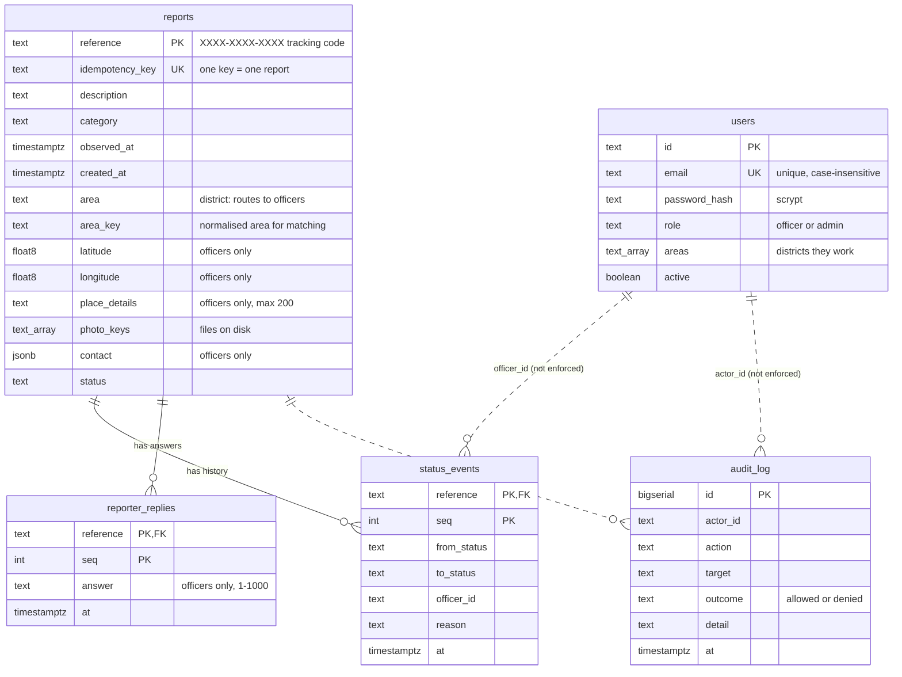

# Database schema

PostgreSQL. The schema is created by the migrations in [`apps/api/migrations`](../apps/api/migrations), applied in
name order when the API starts and by `npm run migrate`. **Never edit an applied migration**: add a new numbered file
(`004_...sql`). This document describes the result after migrations 001 to 003. It was checked against a live database.

The database enforces the most important rules a second time (allowed statuses, both coordinates or neither, unique
retries, append-only audit log), so a bug in the application code cannot quietly store bad data.

## Tables at a glance

| Table | One row per | Written by |
| --- | --- | --- |
| `reports` | report sent from the website | anonymous reporters (insert), officers (status) |
| `status_events` | status change of a report | officers |
| `reporter_replies` | answer a reporter gave to an officer's question | anonymous reporters (tracking page) |
| `users` | officer or administrator account | administrators (and the dev seed) |
| `audit_log` | officer/admin action, allowed **or refused** | the API, automatically |
| `schema_migrations` | applied migration file | the migration runner |

Reporters have **no account and no row in `users`**: their only key is the report's tracking code (`reports.reference`).

## Relationships

Solid lines are enforced foreign keys. Dotted lines are logical links only: an officer's id stays in a report's
history even if the account is later disabled, and the audit log must keep refusals for ids that do not exist.

## `reports`

| Column | Type | Rules | Notes |
| --- | --- | --- | --- |
| `reference` | text | primary key | The tracking code, `XXXX-XXXX-XXXX` (12 random characters from 32, no I, L, O, U). The reporter's only key, so never put it in URLs or logs |
| `idempotency_key` | text | not null, **unique** | Sent by the website with every retry of the same draft, so a lost connection or double tap can never create two reports |
| `description` | text | not null | 10 to 2000 characters (checked by the domain) |
| `category` | text | not null | `excavation_site`, `river_pollution`, `forest_clearing`, `machinery_or_equipment`, `other` |
| `observed_at` | timestamptz | not null | When the reporter saw it (not in the future, a few minutes of clock skew allowed) |
| `created_at` | timestamptz | not null | When the API received it |
| `area` | text | not null | A district from `packages/shared/src/ghana-districts.ts`, or `District not known, <Region> Region`. **Decides which officers see the report.** The only place name shown publicly |
| `area_key` | text | not null | `area` lower-cased with tidy spacing, used to match officer areas |
| `latitude`, `longitude` | double precision | both or neither (`CHECK`) | Phone GPS, optional. **Officers only** |
| `place_details` | text | at most 200 characters (`CHECK`) | Town, community or landmark in the reporter's words. **Officers only** (migration 002) |
| `photo_keys` | text[] | not null, default `{}` | Up to 5 keys like `photos/<id>.jpg`. The files live on disk (`UPLOAD_DIR`, default `uploads/`), metadata stripped, 300 KB or less |
| `contact` | jsonb | nullable | `{"name"?, "phone"?, "email"?}` only if the reporter chose to give them. **Officers only** |
| `status` | text | one of 7 (`CHECK`) | `received`, `under_review`, `more_information_requested`, `verified`, `rejected`, `referred_for_action`, `closed` |

Index: `reports_area_idx (area_key, created_at DESC)` for an officer's list (their areas, newest first).

## `status_events`

The full history of a report. Primary key `(reference, seq)`; `seq` counts from 0 in order.

| Column | Type | Notes |
| --- | --- | --- |
| `reference` | text | → `reports.reference` |
| `seq` | integer | position in the history |
| `from_status`, `to_status` | text | the move. Allowed moves are in `apps/api/src/domain/status.ts` |
| `officer_id` | text | who made it (`users.id`, not enforced) |
| `reason` | text | required (5+ characters) for `verified`, `rejected`, `more_information_requested`, `referred_for_action`. For `more_information_requested` it is the **question**, which the reporter sees on the tracking page; all other reasons are officers only |
| `at` | timestamptz | when |

A status change rewrites the report's events inside one transaction, and only if the report's status is still what the
officer saw (`UPDATE ... WHERE status = <expected>`). If another officer got there first, nothing is saved and the API
answers 409.

## `reporter_replies`

Answers from the tracking page (migration 003). Primary key `(reference, seq)`.

| Column | Type | Notes |
| --- | --- | --- |
| `reference` | text | → `reports.reference` |
| `seq` | integer | order |
| `answer` | text | 1 to 1000 characters (`CHECK`). **Officers only**: the public page only says that an answer was sent |
| `at` | timestamptz | when. An answer belongs to the latest question asked before it; one answer per question |

## `users`

Officers and administrators only.

| Column | Type | Notes |
| --- | --- | --- |
| `id` | text | primary key |
| `email` | text | unique regardless of capital letters (`users_email_lower_idx` on `lower(email)`) |
| `password_hash` | text | scrypt with a random salt, never the password |
| `role` | text | `officer` or `admin` (`CHECK`). Administrators manage accounts but cannot open or decide reports |
| `areas` | text[] | the districts an officer works, from the same district list as `reports.area` |
| `active` | boolean | a disabled account keeps its row (history stays meaningful) but every request is refused and logged |

## `audit_log`

Every officer or administrator action on reports, **including refused ones** (Requirement 4: refused and logged).

| Column | Type | Notes |
| --- | --- | --- |
| `id` | bigserial | primary key |
| `actor_id` | text | who tried |
| `action` | text | e.g. `reports.list`, `report.view`, `report.verify`, `report.refer_for_action` |
| `target` | text | the report reference, when there is one |
| `outcome` | text | `allowed` or `denied` (`CHECK`) |
| `detail` | text | why it was refused, e.g. "report is outside the officer's areas" |
| `at` | timestamptz | when |

**Append-only:** the trigger `audit_log_append_only` raises an error on any `UPDATE` or `DELETE`, even from someone
with direct database access. Index `audit_log_actor_idx (actor_id, at)` for "what did this account do".

## `schema_migrations`

`name` (primary key) and `applied_at`. The runner applies each file in `apps/api/migrations` once, in a transaction.

## Who may see what

| Data | Public tracking page | Officer (own areas) | Administrator |
| --- | --- | --- | --- |
| Status, category, district (`area`), dates, photo count | yes | yes | counts only (planned) |
| Officer's open question | yes | yes | no |
| Description, photos | no | yes | no |
| Coordinates, `place_details`, `contact` | **never** | yes | no |
| Reporter's answers | no (only "answer sent") | yes | no |
| Reasons in the history, officer ids | no | yes | no |
| `users`, `audit_log` | no | no | yes (planned) |

These rules live in the API (`PublicReportMapper`, `OfficerReportMapper`, `AccessPolicy`), not in the database, and
are covered by tests, including a check over all 200 sample reports.

## Data in a fresh database

- `npm run migrate` creates the tables. The API also runs migrations on start-up.
- In development the API creates or updates the account `officer@example.com` (id `dev-officer-1`) with a new random
  password on each start, working the areas in `DEV_AREAS`.
- `npm run seed:samples` adds 200 labelled synthetic reports (descriptions start with `[SAMPLE]`, contact details use
  `example.com` and `0200000xxx` only). Running it twice adds nothing.
